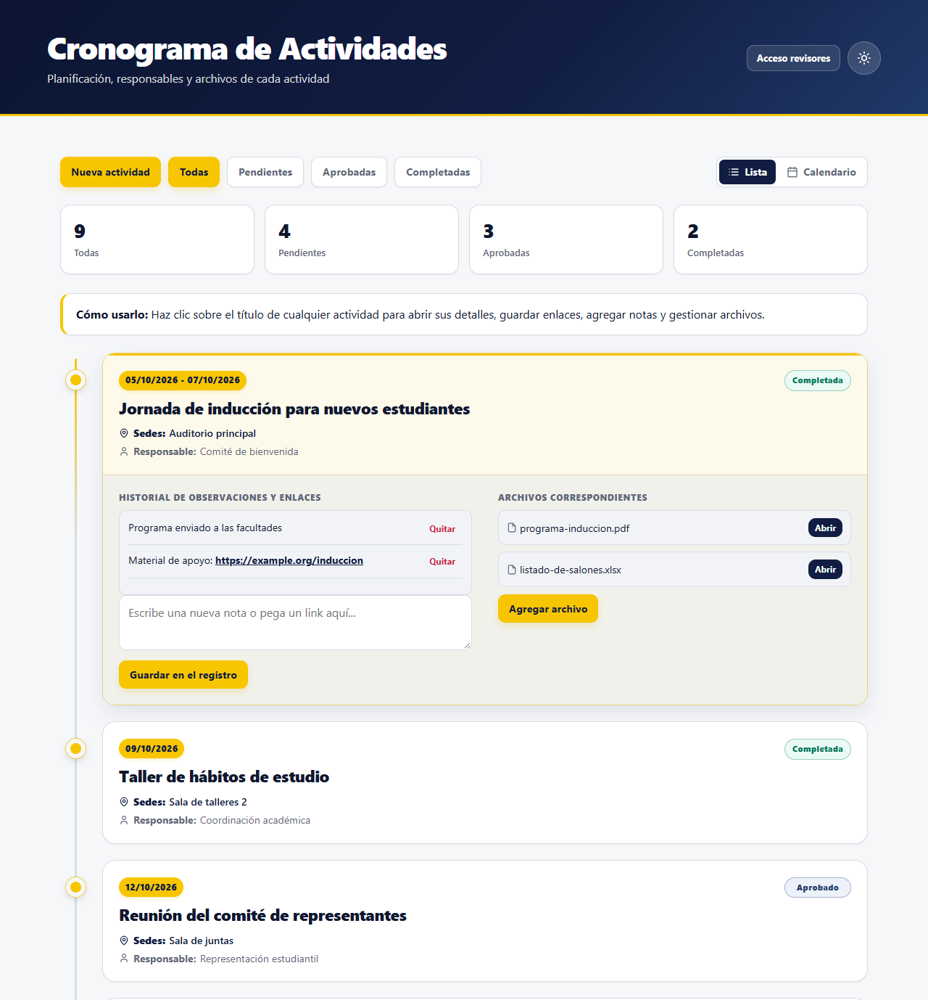
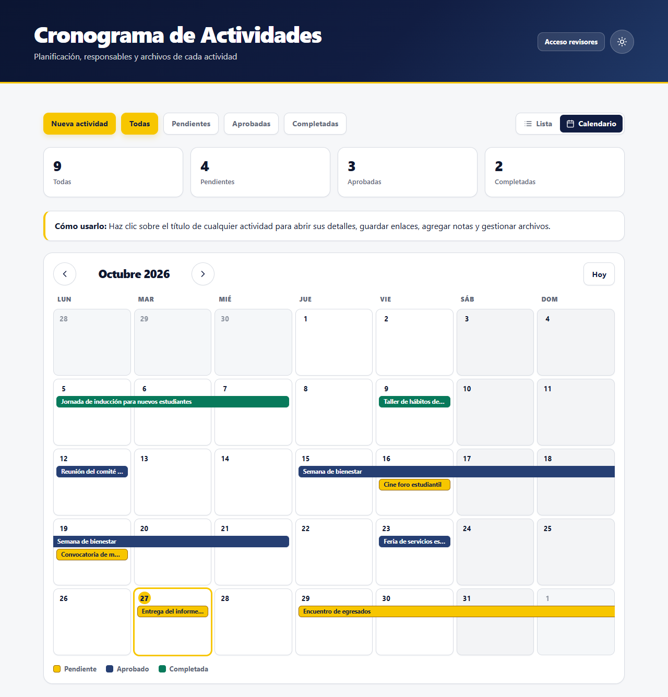
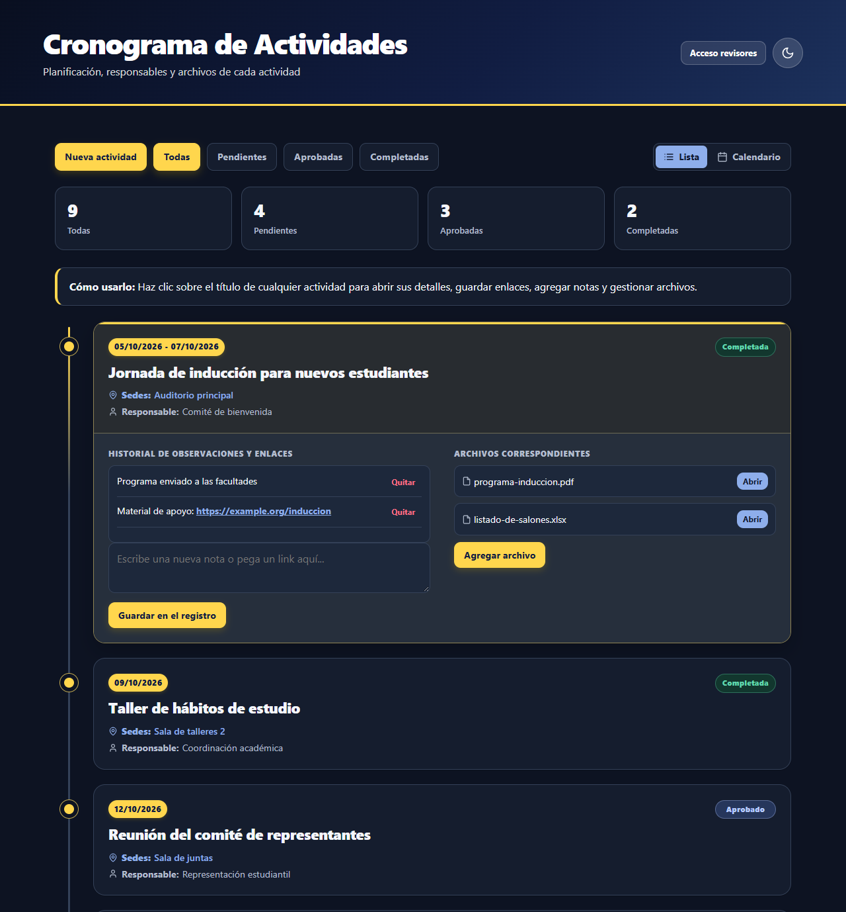
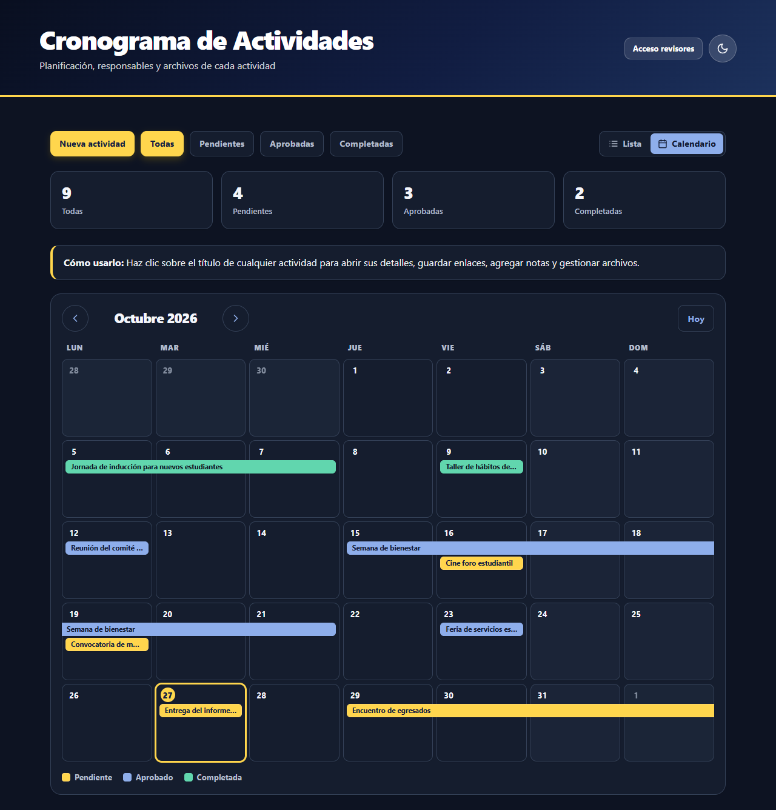
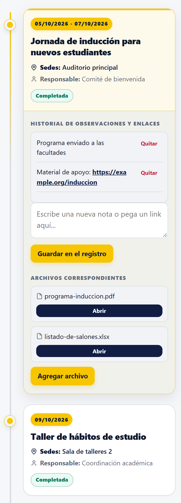
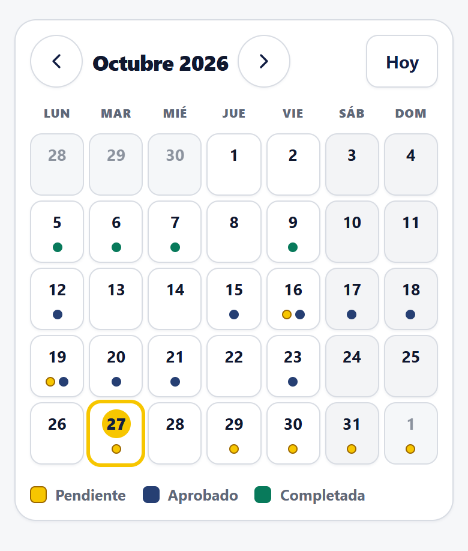
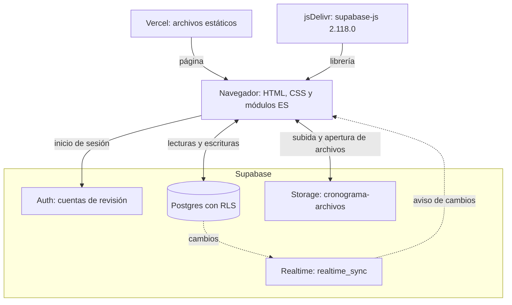

<div align="center">


# Cronograma de Actividades

Planificación, responsables y archivos de cada actividad de una representación estudiantil, en una página web sin compilación.


</div>

## Contenido

- [Descripción y objetivo](#descripción-y-objetivo)
- [Capturas de pantalla](#capturas-de-pantalla)
- [Funcionalidades](#funcionalidades)
- [Roles y permisos](#roles-y-permisos)
- [Arquitectura](#arquitectura)
- [Estructura del proyecto](#estructura-del-proyecto)
- [Ejecución local](#ejecución-local)
- [Configuración](#configuración)
- [Base de datos y seguridad](#base-de-datos-y-seguridad)
- [Despliegue](#despliegue)
- [Flujo de trabajo con Git](#flujo-de-trabajo-con-git)
- [Documentación relacionada](#documentación-relacionada)

## Descripción y objetivo

El cronograma reúne en una sola página las actividades de la representación estudiantil: qué se hace, cuándo, dónde, quién es responsable y en qué estado está (pendiente, aprobada o completada). Cada actividad guarda un registro de notas y enlaces y sus archivos adjuntos.

El objetivo es que cualquier integrante pueda consultar el cronograma y aportar (crear actividades, agregar notas y subir archivos) sin cuenta, mientras que las decisiones (aprobar, editar o eliminar) quedan en manos de las cuentas de revisión. Esas reglas las aplica la base de datos, no la página.

Es un frontend estático (HTML, CSS y módulos ES nativos del navegador, sin compilación ni dependencias npm) que usa Supabase como backend: base de datos Postgres, autenticación, almacenamiento de archivos y tiempo real.

## Capturas de pantalla

Capturas generadas con datos ficticios de ejemplo.

| Vista Lista (tema claro) | Vista Calendario (tema claro) |
|---|---|
|  |  |

| Vista Lista (tema oscuro) | Vista Calendario (tema oscuro) |
|---|---|
|  |  |

<table>
  <tr>
    <th>Móvil: Lista</th>
    <th>Móvil: Calendario</th>
  </tr>
  <tr>
    <td valign="top"></td>
    <td valign="top"></td>
  </tr>
</table>

## Funcionalidades

| Función | Qué hace |
|---|---|
| Línea de tiempo | Tarjetas ordenadas por fecha. Al pulsar el título se abren el estado, el historial de notas y enlaces y los archivos. |
| Calendario mensual | Selector "Lista \| Calendario". Semanas de lunes a domingo, botón "Hoy", rangos de fechas como barras que se parten por semanas, "+N más" si un día tiene más de tres actividades y detalle del día con la misma tarjeta de la lista. La vista elegida se recuerda en el navegador. |
| Filtros por estado | Todas, Pendientes, Aprobadas y Completadas, con contadores. Se aplican a la lista y al calendario. |
| Archivos | Subida con validación previa: PDF, Word, Excel, PowerPoint, JPG, PNG o WebP, de hasta 10 MB y con nombre de hasta 255 caracteres. Se abren desde su enlace público. |
| Notas | Registro de observaciones por actividad; los enlaces se convierten en vínculos que se abren en otra pestaña. |
| Tiempo real | La página escucha los cambios de las tablas de actividades y archivos y se actualiza sola. |
| Acceso de revisores | Inicio de sesión con usuario (`superior`, `académico` o `administración`) y contraseña; la sesión se restaura al volver. |
| Tema claro y oscuro | Botón en el encabezado; la elección se recuerda en el navegador. |
| Diseño adaptable | Ajustes a 1024, 768, 600, 480, 390 y 360 px. En pantallas angostas el calendario muestra puntos de color por día. |
| Accesibilidad | Navegación del calendario con flechas, foco visible, diálogos con cierre por Esc y foco atrapado, y avisos por `aria-live`. |

## Roles y permisos

Esta tabla es la referencia única de permisos. Refleja las políticas RLS y el trigger de [`supabase/roles.sql`](supabase/roles.sql) y [`supabase/roles-2.sql`](supabase/roles-2.sql) aplicados en ese orden. Los tres roles de revisión (`superior`, `academico` y `administracion`) tienen exactamente los mismos permisos.

| Acción | Público (sin sesión) | Revisores |
|---|---|---|
| Ver actividades y archivos | Sí | Sí |
| Abrir archivos (enlace público) | Sí | Sí |
| Crear actividades | Sí, solo con estado "Pendiente" | Sí, con cualquier estado |
| Subir archivos | Sí | Sí |
| Agregar notas | Sí | Sí |
| Borrar notas | Sí (pendiente de restringir) | Sí |
| Editar el texto de las notas | La página no lo ofrece, pero la base permite reescribir el campo de notas (pendiente de restringir) | Igual que el público |
| Editar título, fecha, sedes y responsable | No | Sí |
| Cambiar el estado | No | Sí |
| Eliminar actividades | No | Sí |
| Eliminar archivos (registro y archivo del bucket) | No | Sí |
| Listar o descargar el bucket por la API | No | Sí |
| Modificar el registro de un archivo ya subido | No | No |

> [!NOTE]
> Agregar y borrar una nota son el mismo cambio del campo `notes`, así que hoy la base no puede distinguirlos. Está previsto mover las notas a su propia tabla para restringir el borrado.

## Arquitectura



Vercel solo entrega archivos estáticos: no hay servidor propio ni compilación. El navegador habla directamente con Supabase usando la clave pública del proyecto; Auth identifica a los revisores, Storage guarda los archivos y Realtime avisa de los cambios para que la página vuelva a leer los datos. Todo control de acceso ocurre en Supabase mediante RLS y un trigger.

## Estructura del proyecto

```text
.
├── index.html            Página única: encabezado, filtros, lista, calendario, modales y red de seguridad del arranque
├── favicon.ico           Favicon en la raíz
├── assets/
│   ├── logo.png          Logo de la pantalla de inicio
│   └── favicon/          Iconos de la pestaña, del móvil y site.webmanifest
├── css/                  Se enlazan en este orden (la cascada importa)
│   ├── variables.css     Paleta, tema claro y oscuro, radios, sombras y colores de estado
│   ├── base.css          Caja, cuerpo, encabezado, botones, campos y foco
│   ├── splash.css        Animaciones de la pantalla de inicio
│   ├── componentes.css   Filtros, resumen, línea de tiempo, tarjetas, notas, archivos y modales
│   ├── calendario.css    Selector de vista, mes, etiquetas, leyenda y detalle del día
│   └── responsive.css    Ajustes por ancho de pantalla (siempre el último)
├── js/                   Módulos ES; main.js es el punto de entrada
│   ├── config.js         Cliente de Supabase y manejo de errores de escritura
│   ├── estado.js         Constantes (límites de subida, textos) y estado compartido
│   ├── auth.js           Acceso de revisores, sesión y rol
│   ├── actividades.js    Lectura, creación, edición, estado y eliminación
│   ├── archivos.js       Validación, subida, apertura y borrado de archivos
│   ├── notas.js          Registro de notas
│   ├── calendario.js     Vista de calendario mensual
│   ├── ui.js             Iconos, tema, tarjetas, filtros, modales y eventos
│   └── main.js           Arranque, tema guardado, sesión y tiempo real
├── supabase/
│   ├── roles.sql         Tabla perfiles, función es_revisor() y políticas RLS
│   ├── roles-2.sql       Trigger de edición, límites de longitud y estado al crear
│   └── LEEME.md          Guía paso a paso para aplicar los scripts
├── docs/
│   ├── GUIA-TRASPASO.md  Guía para quien hereda el cargo
│   └── img/              Capturas del README
├── CLAUDE.md             Notas técnicas detalladas del proyecto
└── README.md
```

## Ejecución local

No hay que instalar dependencias. Hace falta Python (para un servidor local) y conexión a internet.

```bash
python -m http.server 8080
```

Después abre <http://localhost:8080>.

> [!WARNING]
> El servidor local usa el **mismo proyecto de Supabase que el sitio publicado**. Todo lo que crees, edites o borres en local se guarda de verdad y lo ve todo el mundo.

<details>
<summary>Por qué no basta con abrir <code>index.html</code> con doble clic</summary>

La página usa módulos ES (`<script type="module">`), y los navegadores no los cargan desde direcciones `file://`. Abierta con doble clic, la página se queda en la pantalla de inicio y, a los 8 segundos, la red de seguridad del arranque muestra el aviso "No se pudo cargar la aplicación. Revisa tu conexión y recarga la página.".

En Windows, el servidor de Python a veces rechaza alguna de las peticiones en paralelo y aparece ese mismo aviso; basta con recargar. En Vercel no ocurre.

</details>

## Configuración

La URL del proyecto de Supabase y su clave pública (la clave *publishable*, con prefijo `sb_publishable_`) están escritas en [`js/config.js`](js/config.js). La versión de supabase-js se fija en el `<head>` de [`index.html`](index.html).

La clave pública está en el código **a propósito**: cualquier página que use Supabase desde el navegador la entrega a quien la visita. No da permisos por sí misma; solo identifica el proyecto. Lo que cada visitante puede hacer lo deciden las políticas RLS y el trigger de la base de datos.

Por eso ocultar un botón en la página no es una medida de seguridad: la página oculta los controles que el rol actual no puede usar solo por comodidad, pero alguien podría llamar a la API directamente con la clave pública, y es entonces cuando Supabase rechaza lo que no está permitido.

> [!WARNING]
> La clave `service_role` se salta todas las reglas de RLS. Nunca debe aparecer en este repositorio ni en la página.

## Base de datos y seguridad

| Recurso | Contenido |
|---|---|
| `cronograma_actividades` | `id`, `title`, `date` (`dd/mm/aaaa` o `dd/mm/aaaa - dd/mm/aaaa`), `location`, `responsible`, `status` (`pending`, `approved` o `done`) y `notes` |
| `cronograma_archivos` | `id`, `activity_id` (referencia a la actividad, con borrado en cascada), `name`, `path` (único) y `type` |
| `perfiles` | `id` (usuario de Supabase Auth) y `rol` (`superior`, `academico` o `administracion`); cada usuario solo puede leer su propio perfil |
| Bucket `cronograma-archivos` | Archivos adjuntos. Es público: los archivos se abren por su enlace, que no pasa por RLS |

Resumen de las reglas (el detalle de permisos está en [Roles y permisos](#roles-y-permisos)):

- La función `es_revisor()` comprueba si el usuario actual tiene uno de los tres roles en `perfiles`.
- Las políticas RLS permiten ver y crear a todos, pero eliminar solo a revisores, en las dos tablas y en el bucket.
- El trigger `cronograma_actividades_solo_notas` impide que quien no es revisor cambie algo distinto de las notas.
- Restricciones `CHECK` limitan la longitud de los textos (por ejemplo, 300 caracteres para el título) y los valores válidos del estado.
- Al borrar una actividad, la base borra sus registros de archivos, pero no los archivos del bucket: la página los borra antes de eliminar la actividad.

Los scripts se ejecutan a mano en el SQL Editor de Supabase, **en este orden**:

1. [`supabase/roles.sql`](supabase/roles.sql)
2. [`supabase/roles-2.sql`](supabase/roles-2.sql)

> [!WARNING]
> Si se vuelve a ejecutar `roles.sql`, deshace parte de `roles-2.sql`. Después hay que ejecutar `roles-2.sql` otra vez.

La guía completa (respaldo previo, creación de cuentas, asignación de roles, pruebas y reversión) está en [`supabase/LEEME.md`](supabase/LEEME.md).

## Despliegue

El sitio se publica en Vercel como sitio estático: no hay paso de compilación y Vercel sirve los archivos del repositorio tal cual. Con la integración de Git de Vercel, cada push a `main` actualiza el sitio publicado y las demás ramas generan vistas previas con su propia dirección.

> [!WARNING]
> Las vistas previas de otras ramas usan **la misma base de datos** que el sitio publicado. Lo que se haga en una vista previa afecta a los datos reales.

> [!NOTE]
> La configuración de Vercel no está en el repositorio (no hay `vercel.json`): la rama de producción y las vistas previas se revisan en el panel de Vercel.

## Flujo de trabajo con Git

- Una rama por cambio, creada desde `main`, con prefijo según el tipo: `feature/` (funciones nuevas), `ajuste/` (correcciones y retoques) y `docs/` (documentación).
- Commits pequeños, con mensajes en español que digan qué cambia.
- Se prueba en local antes de fusionar.
- La rama se fusiona en `main` con un commit de merge:

```bash
git checkout main
git merge --no-ff ajuste/mi-cambio
git push origin main
```

## Documentación relacionada

| Documento | Para qué sirve |
|---|---|
| [`docs/GUIA-TRASPASO.md`](docs/GUIA-TRASPASO.md) | Guía para quien hereda el cargo: servicios, cuentas, respaldos y qué hacer si algo falla |
| [`supabase/LEEME.md`](supabase/LEEME.md) | Aplicar y probar los scripts de roles y permisos en Supabase |
| [`CLAUDE.md`](CLAUDE.md) | Notas técnicas detalladas: estructura, convenciones y decisiones de diseño |
