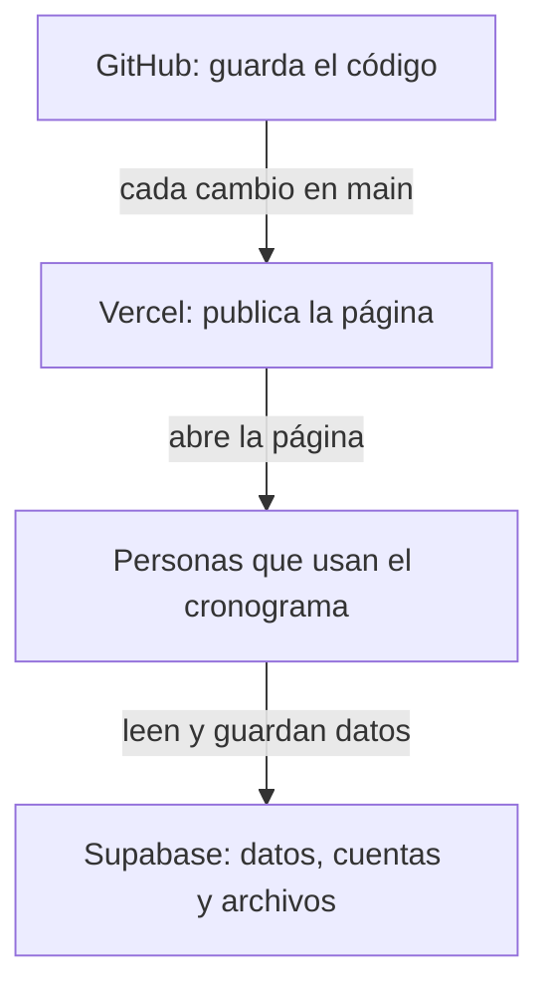

# Guía de traspaso del Cronograma de Actividades

Esta guía es para la persona que **hereda el cargo** y pasa a encargarse del cronograma. No hace falta saber programar para casi nada de lo que aparece aquí: la mayoría de tareas se hacen desde páginas web (los paneles de GitHub, Vercel y Supabase).

Los datos marcados con **[COMPLETAR]** los debe rellenar la persona saliente antes de entregar el cargo.

## Contenido

1. [Mapa de servicios](#1-mapa-de-servicios)
2. [Cuentas de revisores](#2-cuentas-de-revisores)
3. [Cambiar la persona de un cargo](#3-cambiar-la-persona-de-un-cargo)
4. [Crear o desactivar una cuenta de revisor](#4-crear-o-desactivar-una-cuenta-de-revisor)
5. [Respaldos](#5-respaldos)
6. [Si algo falla](#6-si-algo-falla)
7. [Tareas periódicas](#7-tareas-periódicas)
8. [Seguridad](#8-seguridad)
9. [Cómo hacer un cambio en el código](#9-cómo-hacer-un-cambio-en-el-código)
10. [Glosario](#10-glosario)

---

## 1. Mapa de servicios

El cronograma funciona con tres servicios en internet. Cada uno tiene su propio panel y sus propias cuentas de acceso.



| Servicio | Qué hace | Qué acceso necesita la persona responsable | Quién tiene acceso hoy |
|---|---|---|---|
| **GitHub** | Guarda el código de la página y su historial de cambios. | Propietario del repositorio o colaborador con permiso de escritura, para poder publicar cambios. | [COMPLETAR] |
| **Vercel** | Publica la página en internet a partir del código de GitHub. | Miembro del equipo o cuenta que contiene el proyecto, con permiso para ver los despliegues y cambiar la configuración. | [COMPLETAR] |
| **Supabase** | Guarda las actividades, las notas, los archivos adjuntos y las cuentas de los revisores. Aplica las reglas de permisos. | Miembro de la organización con rol **Owner** o **Administrator**, para gestionar usuarios, ejecutar SQL y exportar datos. | [COMPLETAR] |

Datos de referencia:

- Dirección pública del cronograma: [COMPLETAR]
- Nombre del repositorio en GitHub: [COMPLETAR]
- Nombre del proyecto en Vercel: [COMPLETAR]
- Nombre del proyecto en Supabase y plan contratado (gratuito o de pago): [COMPLETAR]
- Dónde se guardan las contraseñas de los revisores (por ejemplo, un gestor de contraseñas del cargo): [COMPLETAR]

> [!NOTE]
> Lo ideal es que los tres servicios estén a nombre de una cuenta del cargo (o de una organización), no de una persona. Así el traspaso es solo cambiar contraseñas y accesos, sin mover proyectos.

## 2. Cuentas de revisores

Los revisores pueden editar actividades, cambiar su estado y eliminar actividades y archivos. Cualquier otra persona puede ver, crear actividades (como "Pendiente"), subir archivos y agregar notas sin iniciar sesión.

Hay **tres cuentas**, una por **cargo**:

| Usuario que se escribe en la página | Correo técnico en Supabase | Rol |
|---|---|---|
| `superior` | `superior@cronograma.local` | `superior` |
| `académico` | `academico@cronograma.local` | `academico` |
| `administración` | `administracion@cronograma.local` | `administracion` |

- En la página se entra con el botón **Acceso revisores**, escribiendo el **usuario** (no el correo). Da igual usar tildes o mayúsculas: `Académico`, `ACADEMICO` y `academico` valen igual.
- El dominio `cronograma.local` **no existe**: estas cuentas **no reciben correos**. No sirve "olvidé mi contraseña"; la contraseña se cambia desde Supabase (sección 3).
- Las cuentas son del **cargo**, no de la persona. Cuando cambia quien ocupa un cargo, **no se crea una cuenta nueva**: se cambia la contraseña.
- Los tres roles tienen los mismos permisos.

## 3. Cambiar la persona de un cargo

Hazlo el mismo día del cambio de directiva. Ejemplo con el cargo académico (para otro cargo, cambia el correo).

**Cambiar la contraseña**

1. Entra en <https://supabase.com/dashboard> y abre el proyecto del cronograma.
2. Menú izquierdo: **Authentication → Users**.
3. Busca `academico@cronograma.local`, ábrela y cambia la contraseña si el panel ofrece esa opción. Usa una contraseña segura de al menos 12 caracteres.
4. Si el panel no ofrece esa opción, ve a **SQL Editor → New query**, pega lo siguiente, escribe la contraseña nueva **solo dentro del editor** y pulsa **Run**:

   ```sql
   update auth.users
   set encrypted_password = extensions.crypt('ESCRIBE-AQUI-LA-NUEVA', extensions.gen_salt('bf')),
       updated_at = now()
   where email = 'academico@cronograma.local';
   ```

5. Después **borra esa consulta** del SQL Editor (no la guardes), para que la contraseña no quede en el historial.

**Cerrar las sesiones abiertas de la persona saliente**

Cambiar la contraseña **no** cierra las sesiones que ya estaban iniciadas.

6. En **SQL Editor → New query** ejecuta:

   ```sql
   delete from auth.sessions
   where user_id = (select id from auth.users where email = 'academico@cronograma.local');
   ```

7. Su acceso termina, como mucho, cuando caduque el permiso que ya tenía (1 hora por defecto).

**Entregar la contraseña**

8. Entrega la contraseña nueva a la persona entrante **en persona o por un medio privado**, nunca por un chat de grupo ni por correo sin cifrar.
9. Pídele que pruebe a entrar con **Acceso revisores**: en el encabezado debe aparecer el nombre del rol y el botón **Cerrar sesión**.

El rol no hay que tocarlo: sigue asociado a la cuenta.

## 4. Crear o desactivar una cuenta de revisor

> [!WARNING]
> La página solo acepta los tres usuarios `superior`, `académico` y `administración` (están escritos en `js/auth.js`). Una cuenta con otro nombre se puede crear en Supabase, pero **no podrá entrar desde la página** sin cambiar el código.

**Volver a crear una de las tres cuentas** (por ejemplo, si se borró por error):

1. **Authentication → Users → Add user → Create new user**.
2. Escribe el correo exacto de la tabla de la sección 2 y una contraseña segura.
3. Marca **Auto Confirm User**. Es obligatorio: el dominio no recibe correos y la cuenta nunca se confirmaría.
4. Pulsa **Create user**.
5. Asigna el rol: **SQL Editor → New query**, pega y ejecuta:

   ```sql
   insert into public.perfiles (id, rol)
   select id,
          case email
            when 'superior@cronograma.local'       then 'superior'
            when 'academico@cronograma.local'      then 'academico'
            when 'administracion@cronograma.local' then 'administracion'
          end
   from auth.users
   where email in ('superior@cronograma.local', 'academico@cronograma.local', 'administracion@cronograma.local')
   on conflict (id) do update set rol = excluded.rol;
   ```

6. Prueba a entrar en la página. Si el encabezado dice "Sin rol asignado", el paso 5 no se aplicó.

**Desactivar una cuenta** (por ejemplo, si un cargo queda vacante):

1. Cambia su contraseña y cierra sus sesiones (sección 3) y no la entregues a nadie.
2. Si además quieres quitarle los permisos de revisión, **SQL Editor → New query**:

   ```sql
   delete from public.perfiles
   where id = (select id from auth.users where email = 'academico@cronograma.local');
   ```

   Para devolverle el rol más adelante, repite el paso 5 de arriba.

Más detalle en [`supabase/LEEME.md`](../supabase/LEEME.md).

## 5. Respaldos

Un respaldo es una copia de los datos guardada fuera de Supabase. Recomendación: **una vez al mes** y **siempre antes de un cambio grande** (cambio de directiva, cambios en la base de datos o en el código).

**Exportar las dos tablas a CSV**

1. Entra en el proyecto de Supabase.
2. Menú izquierdo: **Table Editor**.
3. Abre la tabla `cronograma_actividades` y usa la opción de **exportar a CSV** (está en el menú de la tabla o en el botón de exportar, según la versión del panel).
4. Repite con la tabla `cronograma_archivos`.
5. Si no encuentras la opción, ve a **SQL Editor → New query**, ejecuta `select * from public.cronograma_actividades;`, descarga el resultado como CSV y repite con `select * from public.cronograma_archivos;`.
6. Guarda los archivos con la fecha en el nombre (por ejemplo `actividades-2026-10.csv`) en: [COMPLETAR: carpeta compartida del cargo].

> [!NOTE]
> El CSV guarda los datos de las actividades y la lista de archivos, pero **no los archivos en sí**. Los documentos importantes descárgalos también desde **Storage → cronograma-archivos**.

## 6. Si algo falla

<details>
<summary><strong>La página carga pero no aparecen actividades</strong></summary>

La causa más habitual es que el proyecto de Supabase esté **pausado**: en el plan gratuito, Supabase pausa los proyectos que pasan un tiempo sin uso.

1. Entra en <https://supabase.com/dashboard>.
2. Si el proyecto aparece como pausado (*Paused*), ábrelo y pulsa **Restore project**.
3. Espera a que termine (puede tardar unos minutos) y recarga el cronograma.

Si el proyecto no está pausado, revisa tu conexión a internet y recarga la página.

</details>

<details>
<summary><strong>Aparece el aviso "No se pudo cargar la aplicación. Revisa tu conexión y recarga la página."</strong></summary>

Es la red de seguridad del arranque: aparece si a los 8 segundos la página no logró arrancar (falló la conexión o no se descargó alguna parte).

1. Pulsa **Recargar**.
2. Si se repite, prueba desde otra red o con otro navegador.
3. Si se repite en todas partes, revisa en Vercel que el último despliegue esté bien (siguiente apartado).

</details>

<details>
<summary><strong>Se hizo un cambio en el código pero el sitio no se actualiza</strong></summary>

1. Recarga la página forzando la descarga: **Ctrl + F5** (en Mac, **Cmd + Shift + R**).
2. En el panel de Vercel, abre el proyecto y la pestaña **Deployments**. El último despliegue de `main` debe aparecer como listo (*Ready*).
3. Si aparece con error, ábrelo para ver el motivo. Si no aparece ningún despliegue nuevo, comprueba en GitHub que el cambio llegó a la rama `main` (no solo a otra rama).

</details>

<details>
<summary><strong>Se borró algo por error</strong></summary>

La página **no tiene papelera ni deshacer**.

- **Una actividad**: se puede volver a crear a mano copiando los datos del último respaldo CSV (sección 5). Sus archivos adjuntos se borraron también del almacenamiento; si están en el respaldo de archivos, súbelos otra vez.
- **Una nota**: se puede volver a escribir. Si estaba en el respaldo, cópiala desde el CSV (columna `notes`).
- **Un archivo**: se borra del almacenamiento y no se puede recuperar desde la página. Súbelo de nuevo desde tu copia.

Consulta también en el panel de Supabase (**Database → Backups**) qué copias automáticas ofrece el plan contratado.

</details>

<details>
<summary><strong>No se puede subir un archivo</strong></summary>

La página rechaza el archivo antes de subirlo y explica el motivo. Se permiten:

- **Tipos**: PDF, Word, Excel, PowerPoint, JPG, PNG o WebP.
- **Tamaño**: hasta 10 MB por archivo.
- **Nombre**: hasta 255 caracteres.

Si el archivo cumple todo y aun así falla, puede ser un problema de conexión o que Supabase esté pausado (primer apartado).

</details>

<details>
<summary><strong>Aparece "No tienes permisos para realizar esta acción"</strong></summary>

La acción solo la pueden hacer los revisores (editar, cambiar el estado o eliminar). Inicia sesión con **Acceso revisores**. Si ya habías iniciado sesión y el encabezado dice "Sin rol asignado", falta asignar el rol (sección 4, paso 5).

</details>

## 7. Tareas periódicas

**Cada mes**

- [ ] Exportar las dos tablas a CSV (sección 5) y guardarlas con la fecha.
- [ ] Abrir el cronograma y comprobar que carga las actividades.
- [ ] Entrar en Supabase para confirmar que el proyecto no está pausado.

**En cada cambio de directiva**

- [ ] Hacer un respaldo completo antes del cambio (sección 5).
- [ ] Cambiar la contraseña de cada cargo que cambia de persona y cerrar sus sesiones (sección 3).
- [ ] Entregar las contraseñas nuevas por un medio privado.
- [ ] Revisar quién tiene acceso a GitHub, Vercel y Supabase; dar acceso a las personas entrantes y quitárselo a las salientes.
- [ ] Actualizar los datos marcados con [COMPLETAR] en esta guía.

## 8. Seguridad

- **Nunca** compartas contraseñas por chats de grupo, por correo ni en documentos compartidos abiertos.
- **Nunca** escribas contraseñas ni claves en archivos del repositorio: el código es visible para otras personas.
- **La clave pública** (empieza por `sb_publishable_` y está en `js/config.js`) **es pública a propósito**. Cualquier página que use Supabase la entrega al navegador. Por sí sola no da permisos: lo que cada persona puede hacer lo deciden las reglas de la base de datos.
- **La clave `service_role`** aparece en el panel de Supabase (en la configuración de la API) y se salta **todas** las reglas de permisos. **Nunca** debe usarse en la página, copiarse en el repositorio ni compartirse. Si sospechas que se filtró, cámbiala desde el panel de Supabase de inmediato.
- Ocultar un botón en la página **no** protege nada; la protección real está en Supabase.

## 9. Cómo hacer un cambio en el código

Esta parte sí requiere algo de práctica técnica. Hacen falta **Git** y **Python** instalados.

1. **Clonar** (solo la primera vez): copia el repositorio en tu ordenador.

   ```bash
   git clone [COMPLETAR: dirección del repositorio]
   cd [COMPLETAR: nombre de la carpeta]
   ```

2. **Actualizar `main`** antes de empezar:

   ```bash
   git checkout main
   git pull
   ```

3. **Crear una rama** para el cambio (`feature/` para algo nuevo, `ajuste/` para una corrección, `docs/` para documentación):

   ```bash
   git checkout -b ajuste/descripcion-corta
   ```

4. **Ejecutar en local**:

   ```bash
   python -m http.server 8080
   ```

   Abre <http://localhost:8080>. No abras `index.html` con doble clic: no funciona.

   **Atención:** en local la página usa **los datos reales**. Lo que crees, edites o borres al probar se guarda de verdad.

5. **Hacer el cambio y probarlo** en el navegador: en tema claro y oscuro, en pantalla ancha y en el móvil (o reduciendo la ventana).
6. **Guardar el cambio** con un mensaje en español que diga qué cambia:

   ```bash
   git add .
   git commit -m "Corrige el texto del botón de ..."
   git push -u origin ajuste/descripcion-corta
   ```

7. **Revisar la vista previa** que genera Vercel para la rama (aparece en el panel de Vercel). Recuerda que también usa los datos reales.
8. **Fusionar en `main`** cuando todo esté bien:

   ```bash
   git checkout main
   git merge --no-ff ajuste/descripcion-corta
   git push origin main
   ```

9. **Comprobar el despliegue**: en Vercel, el despliegue de `main` debe quedar listo; abre el cronograma y recarga con **Ctrl + F5**.

Los detalles técnicos (estructura, convenciones y decisiones) están en [`CLAUDE.md`](../CLAUDE.md) y en el [`README.md`](../README.md).

## 10. Glosario

| Término | Qué significa |
|---|---|
| **RLS** (*Row Level Security*) | Reglas de la base de datos que deciden quién puede ver, crear, cambiar o borrar cada dato. Son la seguridad real del cronograma. |
| **Bucket** | Carpeta de almacenamiento de archivos en Supabase. La del cronograma se llama `cronograma-archivos`. |
| **Despliegue** | Publicar una versión del código para que se vea en internet. Lo hace Vercel. |
| **Rama** | Copia paralela del código donde se prepara un cambio sin afectar a la versión publicada (`main`). |
| **Merge** (fusión) | Incorporar los cambios de una rama a otra; normalmente, a `main` para publicarlos. |
| **Repositorio** | El proyecto en GitHub: el código y todo su historial. |
| **SQL Editor** | Sección del panel de Supabase donde se escriben órdenes directas a la base de datos. |
